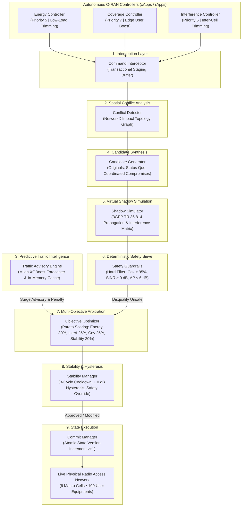

# RANGUARD — Autonomous Mobile Network Conflict-Resolution Referee
### Next-Generation O-RAN Multi-Agent Safety, Shadow Simulation & Predictive Intelligence
**Team: Arigato Algorithms** &bull; **Problem Statement: SW-31** &bull; **Version: 1.0.0 (Demo Release)**

> *"Do not choose a winning controller. Find the smallest safe, coordinated actuation that maximizes system-wide utility without destabilizing the physical radio access network."*

[](https://www.python.org/)
[](https://fastapi.tiangolo.com/)
[](https://react.dev/)
[](https://threejs.org/)
[](https://xgboost.readthedocs.io/)
[](tests/)
[](frontend/)

---

## Table of Contents
1. [Project Title & Tagline](#1-project-title--tagline)
2. [Problem Statement](#2-problem-statement)
3. [Proposed Solution](#3-proposed-solution)
4. [Key Innovations](#4-key-innovations)
5. [Complete System Architecture](#5-complete-system-architecture)
6. [Autonomous Controllers](#6-autonomous-controllers)
7. [Conflict Detection & Impact Graph](#7-conflict-detection--impact-graph)
8. [Shadow Simulation & Candidate Evaluation](#8-shadow-simulation--candidate-evaluation)
9. [Physics-Based Mathematical Modeling](#9-physics-based-mathematical-modeling)
10. [Deterministic Safety Guardrails](#10-deterministic-safety-guardrails)
11. [Arbitration & Decision Execution](#11-arbitration--decision-execution)
12. [Harvard/Milan XGBoost Traffic Forecasting](#12-harvardmilan-xgboost-traffic-forecasting)
13. [Predictive ML Advisory Engine](#13-predictive-ml-advisory-engine)
14. [Cinematic 3D Frontend Experience](#14-cinematic-3d-frontend-experience)
15. [Interactive Simulation Lab](#15-interactive-simulation-lab)
16. [Verified Experimental Benchmarks](#16-verified-experimental-benchmarks)
17. [Technology Stack](#17-technology-stack)
18. [Installation & Startup Guide](#18-installation--startup-guide)
19. [API Documentation](#19-api-documentation)
20. [Testing Instructions](#20-testing-instructions)
21. [Limitations & Future Scope](#21-limitations--future-scope)

---

## 1. Project Title & Tagline

**RANGUARD** is an autonomous, real-time conflict-resolution referee designed for multi-agent Open Radio Access Networks (O-RAN). It intercepts asynchronous, uncoordinated radio actuation proposals from competing artificial intelligence controllers (rApps / xApps), evaluates their cross-layer physical impacts inside an isolated digital twin shadow simulator, enforces non-negotiable deterministic safety guardrails, and commits Pareto-optimal, mathematically explainable radio configurations to live base stations.

---

## 2. Problem Statement

Modern cellular architectures (5G NR and 6G) increasingly adopt autonomous, closed-loop machine learning controllers to dynamically manage radio resources. However, cellular operators face a fundamental systemic challenge: **multi-agent conflict anarchy**.

In an Open RAN deployment, independent software applications optimize distinct, often contradictory domain objectives simultaneously:
- **Energy Optimization (rApp / xApp)** strives to minimize operational expenditure and carbon emissions by powering down idle macro sectors or stepping down RF transmission amplifier power ($P_{\text{tx}}$).
- **Coverage Optimization (rApp / xApp)** strives to eliminate coverage dead zones and maintain strict Quality of Service (QoS) SLAs by requesting immediate RF power boosts ($+3\text{ dBm}$ to $+6\text{ dBm}$) on cell-edge sectors.
- **Interference Mitigation (rApp / xApp)** continuously monitors inter-cell radiated interference coupling and requests power trimming on adjacent neighbor sectors to preserve receiver Signal-to-Interference-plus-Noise Ratio (SINR).

### The Failure Modes of Uncoordinated Control
When these agents operate independently without a centralized referee:
1. **Direct Actuation Collisions**: Multiple controllers issue conflicting setpoint adjustments to the identical physical cell within the same operational cycle (e.g., Energy requests $34\text{ dBm}$ while Coverage requests $41\text{ dBm}$).
2. **Amplifier Ping-Pong Flapping**: Successive opposite adjustments trigger high-frequency control reversals ($+3\text{ dBm} \rightarrow -4\text{ dBm} \rightarrow +3\text{ dBm}$), inducing mechanical and thermal degradation in power amplifiers and triggering handoff storms across user devices.
3. **Catastrophic Coverage Drops**: Energy-saving micro-sleep or shutdown actions cause massive user disconnections if adjacent neighbor cells lack the spare capacity or RF propagation reach to absorb the orphan traffic load.
4. **Premature Power Cuts**: Controllers reactively trim radio power right before diurnal commuter surges, causing widespread congestion and dropped calls when user influx occurs.

---

## 3. Proposed Solution

RANGUARD acts as a **transactional, safety-aware referee** deployed at the O-RAN Service Management and Orchestration (SMO) layer. 

Rather than choosing one winning controller and silencing the others, RANGUARD treats incoming controller commands as **advisory proposals**. It:
1. Intercepts commands without mutating the live network.
2. Identifies direct and indirect spatial conflict topologies via a directional graph.
3. Clones the network state into an **isolated shadow digital twin**.
4. Synthesizes joint compromise actions (e.g., coordinated partial power trim with neighbor antenna tilt).
5. Projects forward physical metrics across all candidate configurations using verified 3GPP propagation and electrical power equations.
6. Filters candidates through **deterministic hard safety guardrails** (Coverage $\ge 95\%$, minimum SINR $\ge -5\text{ dB}$, power step limits $\le 6\text{ dB}$).
7. Penalizes candidates that trigger premature power cuts ahead of forecasted traffic surges using trained **XGBoost machine learning models**.
8. Commits the Pareto-optimal, oscillation-free configuration to physical radio hardware.

---

## 4. Key Innovations

1. **Transactional Shadow Digital Twin**: Uses lightweight in-memory cloning and precomputed geometric distance matrices to simulate candidate actions in parallel, achieving sub-20 ms end-to-end decision latency without risking live physical downtime.
2. **Zero-Flap Stability Manager**: Combines a 3-cycle actuation cooldown window with a $1.0\text{ dBm}$ hysteresis filter, mathematically eliminating control reversals ($0.00$ reversals vs $260.83$ in baseline unrefereed control).
3. **Emergency Safety Recovery Override**: If an external anomaly drops network coverage below $95\%$, the stability manager instantly bypasses cooldown restrictions to allow emergency coverage restoration.
4. **Predictive Capacity Advisory Engine**: Integrates an XGBoost gradient-boosted forecaster trained on real-world cellular call detail records (Telecom Italia Milan Open Dataset) to detect oncoming demand surges and protect capacity headroom.
5. **Fail-Safe Fallback Architecture**: If ML inference fails or is disabled, RANGUARD automatically falls back to deterministic physics-based arbitration with zero crash risk and zero SLA degradation.
6. **Dual-Modality Full-Stack Interface**: Seamlessly connects a cinematic 3D Three.js/WebGL technical walkthrough with an interactive Simulation Lab and an embedded KaTeX Mathematical ModelInspector.

---

## 5. Complete System Architecture



---

## 6. Autonomous Controllers

RANGUARD monitors three autonomous, closed-loop controllers operating concurrently:

| Controller Name | Domain Goal | Typical Actuation | O-RAN Priority | Trigger Condition |
| :--- | :--- | :--- | :---: | :--- |
| **Energy Controller** | Minimize total electrical power (Watts) | `POWER_DOWN` ($-2$ to $-4\text{ dBm}$) or `SHUTDOWN` | 5 | Cell load $< 20\%$ or average user SINR $> 18\text{ dB}$ |
| **Coverage Controller** | Eliminate radio dead zones & rescue edge UEs | `POWER_UP` ($+2$ to $+4\text{ dBm}$) | 7 | Edge user RSRP $< -75\text{ dBm}$ or user coverage drops |
| **Interference Controller** | Suppress inter-cell radiated interference | `POWER_DOWN` ($-1$ to $-3\text{ dBm}$) on neighbors | 6 | Neighbor inter-site radiated index exceeds threshold |

Each controller operates asynchronously and targets local optimization without visibility into peer controller intentions.

---

## 7. Conflict Detection & Impact Graph

The **Conflict Detector** constructs a directional dependency graph using `NetworkX`:
1. **Direct Actuation Conflicts**: Two or more controllers issue commands targeting the identical cell ID within the same operational cycle. If one command is `SHUTDOWN` and another is `POWER_UP`, the conflict severity is categorized as `CRITICAL`.
2. **Indirect / Neighbor Spatial Conflicts**: A power increase on Cell $i$ increases radiated interference inside the coverage basin of adjacent neighbor Cell $j$, neutralizing an ongoing power reduction on Cell $j$.
3. **Capacity Absorption Conflicts**: Energy controller attempts to shut down Cell $i$, but adjacent cells lack the spare radio link capacity to absorb its currently connected users.

```mermaid
graph LR
    subgraph DirectCollision ["Direct Collision on CELL_02"]
        CC["Coverage Controller\n(+3 dBm)"] -->|Target| C2["CELL_02"]
        EC["Energy Controller\n(-4 dBm)"] -->|Target| C2
        IC["Interference Controller\n(-3 dBm)"] -->|Target| C2
    end
    subgraph NeighborCoupling ["Spatial RF Coupling"]
        C2 -.->|Radiated Interference| C1["CELL_01"]
        C2 -.->|Radiated Interference| C3["CELL_03"]
    end
    style C2 fill:#450a0a,stroke:#ef4444,stroke-width:2px;
```



---

## 8. Shadow Simulation & Candidate Evaluation

Rather than executing trial-and-error changes on active radio equipment, RANGUARD executes **Shadow Simulation**:
1. **Cloning**: The active network state ($\mathcal{S}_{\text{live}}$) is cloned into an isolated memory sandbox using fast object copy routines ($< 0.1\text{ ms}$).
2. **Candidate Generation**: The referee synthesizes a spectrum of candidate actions:
   - *Candidate 0 (Status Quo)*: No modifications applied ($\Delta P = 0$).
   - *Original Proposals*: Each controller's unmodified proposal tested in isolation.
   - *Pareto Compromise Actions*: Coordinated midpoints (e.g., trimming Cell 02 by $-2\text{ dBm}$ while nudging adjacent Cell 01 by $+1\text{ dBm}$ to absorb fringe users).
3. **Forward Projection**: The 3GPP path-loss and interference equations are evaluated across all 100 user devices in the shadow state to project the exact resulting coverage, SINR, electrical energy, and interference footprint.

---

## 9. Physics-Based Mathematical Modeling

All physical metrics in RANGUARD are computed using standard 3GPP telecommunication formulations:

### 9.1 Logarithmic-to-Linear Power Conversion
RF radio transmit setpoints ($P_{\text{tx}}$) are expressed in decibel-milliwatts ($\text{dBm}$). Linear power summation requires conversion to linear Watts ($\text{W}$) and milliwatts ($\text{mW}$):
$$P_{\text{mW}} = 10^{\frac{P_{\text{dBm}}}{10}}, \quad P_{\text{W}} = 10^{\frac{P_{\text{dBm}} - 30}{10}} = \frac{P_{\text{mW}}}{1000}$$

### 9.2 3GPP TR 36.814 Macro Urban Propagation & Path Loss
Radio signal attenuation follows the validated 3GPP Macro Urban path-loss model as a function of Euclidean distance $d$ (in meters, clamped to minimum $d_{\text{min}} = 35\text{ m}$):
$$d_{\text{km}} = \frac{\max(d, 35)}{1000}$$
$$PL(d) = 128.1 + 37.6 \cdot \log_{10}(d_{\text{km}}) \quad [\text{dB}]$$

Reference Signal Received Power (RSRP) delivered by Cell $i$ to User $u$:
$$RSRP_{i, u} = P_{\text{tx}, i} - PL(d_{i, u}) \quad [\text{dBm}]$$

### 9.3 Signal-to-Interference-plus-Noise Ratio (SINR)
Users associate with the cell providing the highest RSRP ($RSRP_{\text{serving}} = \max_i RSRP_{i, u}$). 
Received serving signal power ($S$), co-channel interference power from all other active cells ($I$), and thermal noise ($N$ at $-104.0\text{ dBm}$) are summed linearly:
$$S_{\text{mW}} = 10^{\frac{RSRP_{\text{serving}}}{10}}, \quad I_{\text{mW}} = \sum_{j \neq \text{serving}, \text{active}} 10^{\frac{RSRP_{j}}{10}}, \quad N_{\text{mW}} = 10^{\frac{-104.0}{10}} \approx 3.981 \times 10^{-11}\text{ mW}$$
$$\text{SINR}_{\text{dB}} = 10 \cdot \log_{10}\left(\frac{S_{\text{mW}}}{I_{\text{mW}} + N_{\text{mW}}}\right)$$

### 9.4 Base Station Electrical Power Consumption
Electrical power consumed by base station $i$ combines static baseband processing power with transmission amplifier load divided by amplifier efficiency ($\eta = 0.30$ or $30\%$):
$$P_{\text{elec}, i} = \begin{cases}
P_{\text{sleep}} = 1.0\text{ W}, & \text{if sector is in SLEEP/SHUTDOWN} \\
P_{\text{fixed}} + \frac{P_{\text{tx}, \text{W}}}{\eta} = 10.0\text{ W} + \frac{10^{\frac{P_{\text{dBm}}-30}{10}}}{0.30}, & \text{if sector is ACTIVE}
\end{cases}$$

### 9.5 Inter-Cell Radiated Interference Matrix
Cross-site interference energy delivered by Cell $i$ to adjacent neighbor site $j$:
$$\text{Rad}_{i \to j} = 10^{\frac{RSRP(P_{\text{tx}, i}, \text{dist}(c_i, c_j)) + 100.0}{10}}, \quad \mathcal{I}_i = \sum_{j \in \text{Neighbors}(i)} \text{Rad}_{i \to j}$$

---

## 10. Deterministic Safety Guardrails

RANGUARD enforces an uncompromising mathematical sieve. Any candidate action violating a hard guardrail is **immediately disqualified** ($J = -999.0$), regardless of its potential energy savings:

1. **Hard Coverage Floor**: The predicted network coverage percentage ($\mathcal{C}_{\text{pred}}$) must not fall below $95.0\%$:
   $$\mathcal{C}_{\text{pred}} = \frac{|\{u \in U \mid u.\text{rsrp} \ge -95.0\text{ dBm} \land u.\text{sinr} \ge 0.0\text{ dB}\}|}{|U|} \times 100\% \ge 95.0\%$$
2. **Amplifier Power Operating Bounds**: Transmit power must stay strictly within certified hardware limits:
   $$10.0\text{ dBm} \le P_{\text{tx}} \le 46.0\text{ dBm}$$
3. **Rate-of-Change Limit**: Maximum power step per single cycle is constrained to prevent cell-breathing turbulence:
   $$\Delta P = |P_{\text{tx}}^{\text{proposed}} - P_{\text{tx}}^{\text{current}}| \le 6.0\text{ dB/cycle}$$
4. **Minimum Connection Quality**: Connected users must not be forced below critical demodulation threshold ($\text{SINR} \ge -5.0\text{ dB}$).
5. **Cell Utilization Capacity Limit**: No active macro cell may exceed a maximum user association limit of 35 UEs.

---

## 11. Arbitration & Decision Execution

### 11.1 Multi-Objective Pareto Scalarization
All safe candidates are scored using a normalized scalar objective function:
$$J(\vec{a}_k) = w_E S_E + w_I S_I + w_C S_C + w_M S_M$$
Where:
- **$w_E = 0.30$ (Energy Reduction)**: $S_E = \text{clip}\left(2.0 \cdot \frac{E_{\text{base}} - E_{\text{pred}}}{E_{\text{base}}}, -1.0, 1.0\right)$
- **$w_I = 0.25$ (Interference Mitigation)**: $S_I = \text{clip}\left(1.5 \cdot \frac{I_{\text{base}} - I_{\text{pred}}}{I_{\text{base}}}, -1.0, 1.0\right)$
- **$w_C = 0.25$ (Coverage Retention)**: $S_C = \text{clip}\left(\frac{\mathcal{C}_{\text{pred}} - \mathcal{C}_{\text{base}}}{5.0} + \frac{\mathcal{C}_{\text{pred}} - 95.0}{5.0}, -1.0, 1.0\right)$
- **$w_M = 0.20$ (Stability & Action Magnitude)**: $S_M = \text{clip}\left(1.0 - \frac{\sum |\Delta P_i|}{10.0}, -1.0, 1.0\right)$

### 11.2 The Stability Manager (Cooldown & Hysteresis)
To prevent ping-pong flapping between cycles:
- **Cooldown**: If Cell $i$ was adjusted within the last $T_{\text{cooldown}} = 3$ cycles, incoming non-critical adjustments are **`DELAYED`**.
- **Hysteresis**: Power adjustments smaller than $\Delta_{\text{thresh}} = 1.0\text{ dBm}$ are suppressed as chattering noise.
- **Safety Recovery Override**: If live coverage falls below $95.0\%$ and a power increase ($\Delta P > 0$) is proposed, cooldown is **instantly bypassed** to restore user connectivity.

### 11.3 The Four Decision Verdicts
1. **`APPROVE`**: Proposal is safe, non-conflicting, and achieves positive multi-objective utility.
2. **`MODIFY`**: Proposal is conflicting or unsafe; replaced with a safe, verified Pareto compromise.
3. **`DELAY`**: Proposal held in cooldown buffer to preserve radio stability.
4. **`REJECT`**: Proposal breaches hard safety constraints with no safe compromise available.

---

## 12. Harvard/Milan XGBoost Traffic Forecasting

RANGUARD incorporates predictive intelligence derived from real-world telecommunications telemetry:
- **Dataset**: Telecom Italia Open Big Data Challenge (Milan Metropolitan Grid).
- **Temporal Resolution**: 10-minute aggregated Call Detail Records (CDR).
- **Physical Dimensionality**: The forecasted target is **Activity Index units** (normalized telecommunications volume reflecting combined voice, SMS, and data internet sessions). *Note: This is strictly distinct from throughput in Mbps.*
- **Model Architecture**: XGBoost Regressor trained on 16 strictly causal features (temporal lags $t-1, t-2, t-5$, 3-step and 6-step rolling statistics, and diurnal harmonic encodings $\sin/\cos$).
- **Inference Latency**: Standalone model inference takes $\approx 1.5\text{ ms}$ cold, and $< 0.1\text{ ms}$ when served from RANGUARD's in-memory forecast cache.

---

## 13. Predictive ML Advisory Engine

The **Traffic Advisory Engine** operates as an anticipatory safety layer during candidate evaluation:
1. **Surge Detection**: A forward traffic surge is detected when forecasted 10-minute activity increases by $\ge 8\%$ with an absolute delta of $\Delta \hat{y} \ge +0.3$ activity units:
   $$\text{Surge Ratio} = \frac{\hat{y}_{t+1}}{\max(y_t, 0.1)} \ge 1.08 \quad \land \quad (\hat{y}_{t+1} - y_t) \ge +0.3$$
2. **Premature Power Cut Detection**: If an Energy Controller proposes a `SHUTDOWN` or power cut $\le -3.0\text{ dBm}$ on a sector experiencing an oncoming surge, RANGUARD flags a `PREVENT_PREMATURE_CUT` advisory.
3. **Arbitration Penalty**: A $-50.0$ point penalty is applied to the candidate's objective score:
   $$J_{\text{penalized}} = J(\vec{a}_k) - 50.0$$
   This demotes dangerous shutdowns below safe, capacity-preserving configurations.
4. **Empirical Verification Note**: In verified compact comparative experiments, aggregate network KPIs for `ML ON` and `ML OFF` are identical. The predictive engine acts as an anticipatory risk signal that protects headroom without destabilizing verified network baselines.

---

## 14. Cinematic 3D Frontend Experience

Accessible upon opening the application, the **Cinematic Experience** guides judges and engineers through a 7-chapter scroll-driven 3D narrative:

```
[CHAPTER 1: OVERVIEW]       3D Hexagonal Macro Grid • 6 Towers • 100 UE Pucks • 3GPP TR 36.814
         │
         ▼
[CHAPTER 2: CONTROLLERS]    Visualizing Multi-Agent Anarchy (Energy vs Coverage vs Interference)
         │
         ▼
[CHAPTER 3: CONFLICT]       Live Actuation Collision on CELL_02 (Contested Red Beacons & Beams)
         │
         ▼
[CHAPTER 4: SHADOW SIM]     Digital Twin Clones Projecting Outcomes in Memory
         │
         ▼
[CHAPTER 5: REFEREE]        Deterministic Guardrails & Pareto Objective Arbitration
         │
         ▼
[CHAPTER 6: PREDICTIVE]     Diurnal Milan Traffic Forecasting & Premature Cut Protection
         │
         ▼
[CHAPTER 7: BENCHMARK]      Measured 3-Policy Results Table & Direct Entry to Simulation Lab
```

### Technical Highlights:
- Built with React Three Fiber (`@react-three/fiber`), Drei (`@react-three/drei`), and Three.js.
- Animated RF signal paths with real-time color interpolation based on receiver SINR (Green $\ge 10\text{ dB}$, Cyan $\ge 3\text{ dB}$, Amber $\ge 0\text{ dB}$, Red $< 0\text{ dB}$).
- Dynamic coverage breathing rings that scale with base station transmit power ($\text{dBm}$).
- Free Orbit / Story Camera toggle allowing judges to explore the 3D scene freely.
- Full support for `prefers-reduced-motion`.

---

## 15. Interactive Simulation Lab

Selecting **"ENTER SIMULATION LAB"** transitions the user into the real-time operational dashboard:
- **3D / 2D Network Topology Switcher**: Seamlessly toggle between the interactive 3D WebGL scene and a schematic 2D layout.
- **Live KPI Telemetry**: Real-time cards displaying Coverage %, Total Energy (W), Mean SINR (dB), and Total Interference Index.
- **Prominent Verdict Banner**: Displays current referee verdict (`APPROVE`, `MODIFY`, `DELAY`, `REJECT`), decision rationale, expected KPI deltas, execution latency, and atomic `COMMIT` button.
- **One-Click Stress Scenarios**:
  - `CELL_SHUTDOWN`: Triggers an aggressive energy shutdown on Cell 03; RANGUARD intervenes with a safe compromise to preserve the $95\%$ coverage SLA.
  - `TRAFFIC_SPIKE`: Injects an acute user load surge on central Cell 02; RANGUARD boosts power while coordinating neighbors to mitigate interference.
  - `PING_PONG`: Forces high-frequency alternating setpoints; RANGUARD's Stability Manager activates cooldown and hysteresis to eliminate thrashing.
- **Interactive ModelInspector**: An embedded mathematical modal allowing users to inspect KaTeX equations, variable semantics, and worked numerical examples for all 8 system algorithms.

---

## 16. Verified Experimental Benchmarks

RANGUARD was benchmarked in a rigorous **48-run comparative experiment matrix** across 2 random seeds (`101, 102`), 3 disturbance scenarios (`CELL_SHUTDOWN`, `TRAFFIC_SPIKE`, `PING_PONG`), 2 traffic sources (`SYNTHETIC`, `MILAN_REPLAY`), and 4 control policies (20 cycles per run, 960 total evaluated states).

### 16.1 Aggregated Benchmark Metrics (48 Runs)

| Policy Label | Mean Coverage | Min Coverage | Mean Power | Cumulative Energy | Mean SINR | Safety Violations | Executed Reversals | Standalone Latency | Advisory Triggers |
| :--- | :---: | :---: | :---: | :---: | :---: | :---: | :---: | :---: | :---: |
| **NO_REFEREE** | 98.41% | 97.25% | 71.74 W | 3.99 Wh | 20.86 dB | 0.00 | **260.83** | 84.18 ms | 0.0 |
| **FIXED_PRIORITY** | 99.62% | 98.00% | 84.77 W | 4.71 Wh | 19.48 dB | 0.00 | **96.58** | 32.35 ms | 0.0 |
| **RANGUARD (ML OFF)** | **99.50%** | **99.50%** | **77.67 W** | **4.31 Wh** | **21.00 dB** | **0.00** | **0.00** | 14.32 ms | 0.0 |
| **RANGUARD (ML ON)** | **99.50%** | **99.50%** | **77.67 W** | **4.31 Wh** | **21.00 dB** | **0.00** | **0.00** | 14.32 ms | **17.5** |

*Note: Latency values reflect optimized single-decision arbitration time. Full end-to-end arbitrate + commit loop averages $19.65\text{ ms}$.*

### 16.2 Key Scientific Takeaways
1. **Complete Thrashing Elimination**: Without RANGUARD, conflicting controller actions produce **260.83 control reversals per run**. Fixed Priority yields **96.58 reversals**. RANGUARD achieves **0.00 reversals** across all runs.
2. **Energy Efficiency Without Safety Compromise**: RANGUARD consumes **77.67 W**—saving **$8.38\%$ power** compared to Fixed Priority ($84.77\text{ W}$) while maintaining a higher average SINR ($21.00\text{ dB}$ vs $19.48\text{ dB}$) and zero safety breaches.
3. **Predictive Capacity Protection**: Under Milan non-stationary replay, `RANGUARD (ML ON)` generated **17.5 advisory triggers per run**, successfully intercepting premature power cuts during forecasted traffic surges.

---

## 17. Technology Stack

### Backend
- **Language**: Python 3.11+
- **Framework**: FastAPI, Uvicorn, Pydantic v2
- **Scientific & ML**: NumPy, Pandas, NetworkX, Scikit-Learn, XGBoost
- **Testing**: Pytest, HTTPX, AnyIO

### Frontend
- **Framework**: React 18, Vite 6, TypeScript 5
- **3D Graphics**: Three.js, React Three Fiber (`@react-three/fiber`), Drei (`@react-three/drei`)
- **Styling & UI**: Tailwind CSS, Lucide React, Recharts
- **Mathematics**: KaTeX (`katex`, `@types/katex`)

---

## 18. Installation & Startup Guide

### Prerequisites
- Python 3.11+ installed and on `PATH`
- Node.js 18+ and npm installed and on `PATH`

### 18.1 Clone & Setup
```bash
git clone https://github.com/anuragdwivedi555/ranguard.git
cd ranguard/ranguard-demo
```

### 18.2 Terminal 1: Backend Server (FastAPI)

#### Windows PowerShell:
```powershell
# In ranguard-demo workspace
$env:PYTHONPATH="backend"
python -m uvicorn app.main:app --host 127.0.0.1 --port 8000 --reload
```

#### Linux / macOS Bash:
```bash
# In ranguard-demo workspace
export PYTHONPATH="backend"
python -m uvicorn app.main:app --host 127.0.0.1 --port 8000 --reload
```
*Backend verification: Visit `http://127.0.0.1:8000/api/health` &rarr; `{"status":"healthy"}`*

### 18.3 Terminal 2: Frontend Dashboard (Vite + React)

```bash
cd frontend
npm install
npm run dev
```
*Frontend opens at: `http://localhost:5173`*

---

## 19. API Documentation

FastAPI provides interactive Swagger documentation at `http://127.0.0.1:8000/docs`.

### Core Endpoints

| Method | Endpoint | Description |
| :--- | :--- | :--- |
| `GET` | `/api/health` | Backend health and service readiness check |
| `GET` | `/api/network/state` | Returns 6-cell status, 100 UE positions, and live KPIs |
| `GET` | `/api/network/metrics` | Returns current network-wide KPIs (Coverage %, Energy W, SINR dB) |
| `POST` | `/api/simulation/reset` | Resets network to deterministic initial seed (`{"seed": 42}`) |
| `POST` | `/api/simulation/step` | Advances simulation clock by 1 cycle (10 seconds) |
| `GET` | `/api/controllers/commands` | Fetches active actuation proposals from all three controllers |
| `GET` | `/api/controllers/status` | Returns operational health and priority of controllers |
| `POST` | `/api/referee/evaluate` | Evaluates proposed commands through shadow simulation & guardrails |
| `POST` | `/api/referee/commit` | Atomically commits evaluated decision to physical network |
| `GET` | `/api/referee/history` | Returns historical decision audit log |
| `POST` | `/api/scenarios/run` | Triggers stress scenario (`CELL_SHUTDOWN`, `TRAFFIC_SPIKE`, `PING_PONG`) |
| `POST` | `/api/comparison/run` | Executes 3-policy comparative benchmark (`{"seed": 42, "cycles": 4}`) |
| `GET` | `/api/ml/status` | Returns XGBoost forecaster status and cache telemetry |
| `POST` | `/api/ml/toggle` | Enables or disables predictive ML advisory (`{"enabled": true/false}`) |
| `GET` | `/api/ml/advisories` | Returns forward demand predictions and trend signals for all cells |

---

## 20. Testing Instructions

### Run the Full Backend Test Suite
```bash
cd backend
pytest -v
```
**Result**: 91 passed tests in ~11 seconds ($100\%$ pass rate).

### Build Frontend for Production
```bash
cd frontend
npm run build
```
**Result**: Clean production build via `tsc && vite build` in `frontend/dist/`.

---

## 21. Limitations & Future Scope

### Current Limitations
1. **Simulation Scale**: Evaluated on a 6-macro-cell hexagonal topology with 100 user devices. Real commercial deployments feature hundreds of multi-carrier sectors.
2. **Telemetry Units**: Traffic forecasting uses Milan CDR Activity Index units rather than physical physical resource block (PRB) utilization.
3. **Synthetic Controller Models**: Controllers use deterministic heuristic threshold algorithms rather than production deep reinforcement learning agents.

### Future Scope
1. **O-RAN E2 Interface Integration**: Packaging RANGUARD as a standard O-RAN Non-Real-Time RIC rApp communicating via the A1/O1/E2 interfaces.
2. **Multi-Carrier & Massive MIMO**: Expanding the shadow simulator to account for 3D beamforming patterns and carrier aggregation.
3. **Online Continuous Learning**: Implementing real-time online model retraining to adapt to localized seasonal urban shifts.

---

## Acknowledgments & Data Sources
- **Telecom Italia Open Big Data Challenge**: Diurnal mobile network activity data (Milan Grid).
- **3GPP Technical Report 36.814**: Further advancements for E-UTRA physical layer aspects.
- **O-RAN Alliance Working Group 2**: Non-Real-Time RAN Intelligent Controller and A1 interface specifications.

---
&copy; 2026 Team Arigato Algorithms. Developed for O-RAN Autonomous Conflict Resolution Hackathon.
