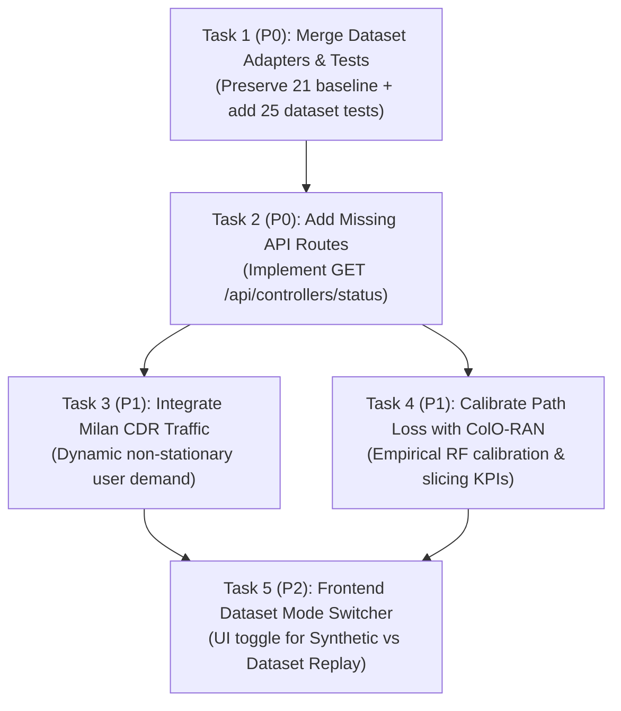

# RANGUARD — Next Steps & Implementation Roadmap

**Document Version:** 1.0.0  
**Date:** November 21, 2026  
**Target Branch:** `feat/integrate-datasets`  
**Baseline Commit:** `dd286ba` (Teammate Baseline)  
**Dataset Source Commit:** `1abdc6f` (`feat/dataset-simulator`)  

---

## Overview

Following the successful baseline technical audit of commit `dd286ba` and the preservation of our dataset engineering work on commit `1abdc6f`, this document defines the actionable, step-by-step engineering roadmap for the next development sprint.

The objective is to unify the 3GPP network simulation baseline with the real-world dataset adapters (ColO-RAN, Harvard Milan, Open RAN Traffic Twinning) without breaking any of the existing 21 backend tests or frontend capabilities.

---

## Prioritized Task Backlog



---

## Detailed Task Specifications

### Task 1 (P0) — Merge Preserved Dataset Ingestion Suite into Baseline
- **Goal:** Unify the dataset adapters, normalization engines, and tests preserved on branch `feat/dataset-simulator` (commit `1abdc6f`) into the current integration branch `feat/integrate-datasets`.
- **Target Directory Structure:**
  ```
  ranguard/
  ├── backend/
  │   ├── app/
  │   │   ├── data_adapters/
  │   │   │   ├── __init__.py
  │   │   │   ├── base.py
  │   │   │   ├── coloran.py
  │   │   │   ├── milan.py
  │   │   │   ├── traffic_twinning.py
  │   │   │   ├── registry.py
  │   │   │   ├── normalization.py
  │   │   │   └── synthetic_fallback.py
  │   └── tests/
  │       ├── test_dataset_adapters.py
  │       ├── test_normalization.py
  │       └── test_synthetic_fallback.py
  └── data/
      └── raw/
          ├── coloran/
          ├── milan/
          └── traffic_twinning/
  ```
- **Execution Strategy:**
  1. Cherry-pick or checkout the dataset files from commit `1abdc6f3d7d3ce3102454ff038c532ea6bfe52e4`:
     ```bash
     git checkout 1abdc6f -- data_adapters/ schemas/ data/ tests/test_dataset_*.py
     ```
  2. Relocate adapter modules into `backend/app/data_adapters/` to maintain clean backend namespace packaging.
  3. Run the complete pytest test suite:
     ```bash
     pytest backend/tests/ -v
     ```
- **Acceptance Criteria:**
  - All 21 original baseline tests pass.
  - All 25 dataset adapter tests pass.
  - Total test count: 46 passing tests, 0 failures.

---

### Task 2 (P0) — Implement Missing `GET /api/controllers/status` Route
- **Goal:** Fix the 404 endpoint discovered during the API audit by implementing controller health and status reporting.
- **Files to Modify:**
  - `backend/app/api/routes/controllers.py`
  - `backend/tests/test_api_endpoints.py`
- **Implementation Details:**
  - Define `ControllerStatusResponse` schema:
    ```python
    class ControllerStatus(BaseModel):
        name: str
        controller_type: str
        status: str  # "active" | "standby"
        target_cells: List[str]
        last_proposal_cycle: Optional[int] = None
        enabled: bool = True
    ```
  - Implement endpoint:
    ```python
    @router.get("/status", response_model=List[ControllerStatus])
    def get_controller_status():
        # Returns current registration and state for Energy, Coverage, Interference controllers
        ...
    ```
- **Acceptance Criteria:**
  - `GET /api/controllers/status` returns HTTP 200 with JSON payload containing 3 active controllers.
  - Integration test added to `test_api_endpoints.py`.

---

### Task 3 (P1) — Exogenous Traffic Demand Injection from Milan CDR
- **Goal:** Replace the static user traffic demand in `NetworkEngine` with dynamic temporal load profiles from the Harvard Milan dataset.
- **Files to Modify:**
  - `backend/app/simulation/engine.py`
  - `backend/app/simulation/traffic.py` (new helper module)
- **Implementation Details:**
  - Introduce `TrafficMode` enum (`SYNTHETIC`, `MILAN_REPLAY`).
  - In `MILAN_REPLAY` mode, load 10-minute CDR Internet activity slices from `MilanCDRAdapter`.
  - Scale total user demand as:
    $$\text{Demand}_u(t) = D_{\text{base}} \cdot \alpha_{\text{milan}}(t, \text{cell}_s)$$
  - During off-peak hours (low Milan CDR activity), user demand drops, naturally provoking the `EnergyController` to propose cell power downs or sleep modes.
  - During peak hours, localized bursts provoke the `CoverageController` and `InterferenceController`.
- **Acceptance Criteria:**
  - Simulation can run with `--traffic-source=milan`.
  - Cell load fluctuates realistically across simulated diurnal cycles.
  - Synthetic fallback activates seamlessly if the CDR file is missing.

---

### Task 4 (P1) — Empirical Path Loss Calibration using ColO-RAN
- **Goal:** Validate and calibrate the theoretical 3GPP path loss model against real-world Rome RF measurements.
- **Files to Modify:**
  - `backend/app/simulation/signal.py`
  - `backend/app/simulation/metrics.py`
- **Implementation Details:**
  - Extract RSRP vs Distance pairs from `ColORANAdapter`.
  - Fit empirical log-distance model:
    $$PL_{\text{empirical}}(d) = PL_0 + 10 \beta \log_{10}(d) + X_\sigma$$
  - Compare theoretical 3GPP ($\beta = 3.76$) with ColO-RAN empirical curve.
  - Add slice throughput modeling based on real-world ColO-RAN PRB allocation and SNR.
- **Acceptance Criteria:**
  - Automated calibration script reports fitting statistics (RMSE, correlation coefficient $R^2$).
  - Unit test verifying path loss predictions match empirical bounds within $\pm 3\text{ dB}$.

---

### Task 5 (P2) — Frontend Dataset Replay Controls & Heatmap Integration
- **Goal:** Surface dataset replay capabilities directly in the React web dashboard.
- **Files to Modify:**
  - `frontend/src/components/Dashboard.tsx`
  - `frontend/src/components/ScenarioControls.tsx`
  - `frontend/src/types/index.ts`
- **Implementation Details:**
  - Add a "Dataset Source" selector in the scenario header:
    - `Synthetic Macro Urban (Default)`
    - `Harvard Milan CDR (Diurnal Load Spike)`
    - `Colosseum ColO-RAN (Empirical Rome RF)`
  - Display empirical vs simulated KPI badges in the `MetricsPanel`.
- **Acceptance Criteria:**
  - Dashboard user can select a dataset mode from a dropdown.
  - Real-time RF heatmap and decision stream reflect dataset-driven load profiles.

---

## Execution Instructions for Task 1

To begin Task 1 immediately when instructed:
```powershell
# 1. Ensure clean working tree
git status

# 2. Extract dataset files from checkpoint commit
git checkout 1abdc6f -- data_adapters/ schemas/ tests/test_dataset_*.py data/raw/

# 3. Relocate to backend package structure
Move-Item -Path data_adapters -Destination backend\app\data_adapters -Force
Move-Item -Path tests\test_dataset_*.py -Destination backend\tests\ -Force

# 4. Execute all tests
python -m pytest backend/tests/ -v
```
